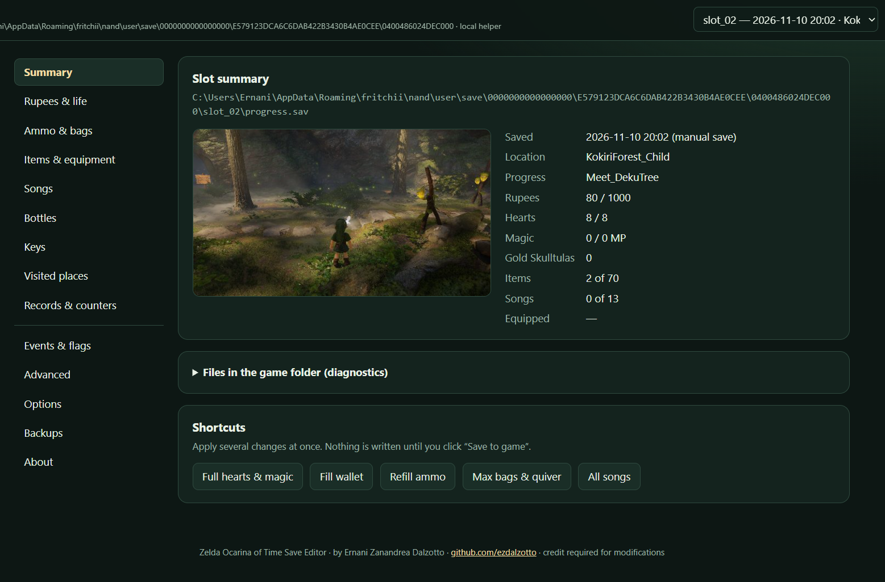

# Zelda Ocarina of Time 2026 Remake Save Editor

Save editor for the **2026 remake** of **Zelda: Ocarina of Time** on PC. Works with the save files of any version (Windows, Linux and others).

> ⚠️ Only for the **2026 remake**. It does **not** work with the original N64 game, Ocarina of Time 3D or Ship of Harkinian.

🇧🇷 [Leia em português](#português)

---

## Download

Download **[Zelda-Ocarina-of-Time-2026-Remake-Save-Editor.html](Zelda-Ocarina-of-Time-2026-Remake-Save-Editor.html)** (open it and click **Download raw file**). It runs in your browser: nothing to install.

## How to use

1. Close the game.
2. Open the `.html` file and click **Select the save folder** (the folder is always called `save`). The editor finds all your saves inside it.
3. Pick the slot, edit and click **Save**. Your original files are downloaded first as a backup.
4. Copy the edited `progress.sav` and `caption.sav` into the folder the editor shows, replacing the old ones.

Interface in **English** and **Portuguese** (EN/PT buttons, top-right).

## Features

- Rupees and wallet, heart containers, current hearts, magic meter and magic
- Ammo and bag/quiver sizes, magic beans, Gold Skulltula tokens, pieces of heart
- Items and equipment: swords, shields, tunics, boots, masks, upgrades, stones and medallions, magic, trading items
- The 12 ocarina songs plus the Scarecrow's Song
- Bottles and their contents, small keys per dungeon
- Visited places, minigame records and counters, Giant's Knife durability
- Event flags and an advanced editor with every field of `progress.sav` (~12,000)
- Voice language (`option.sav`)
- Shortcuts: full hearts/magic, fill wallet, refill ammo, max bags, all songs

## Safety

- **Automatic backup:** every time you save, your original files are downloaded first as `backup_<slot>_<date>_progress.sav` / `caption.sav`.
- Everything runs in your browser. Nothing is installed and nothing is sent to the internet.

## How it works

Field names in the save are MurmurHash3 (x86, 32-bit, seed 0) hashes. Source code is in [`src/`](src): `editor.html` (interface), `catalog.json` (field list) and `build.py` (generates the final `.html`).

## License

MIT License. You may use, modify and redistribute it **as long as you keep the credit to Ernani Zanandrea Dalzotto** ([github.com/ezdalzotto](https://github.com/ezdalzotto)). See [LICENSE](LICENSE).

Unofficial fan tool, not affiliated with Nintendo. Always keep a backup of your save.

---

## Português

Editor de save do **remake de 2026** de **Zelda: Ocarina of Time** para PC. Funciona com os arquivos de save de qualquer versão (Windows, Linux e outras).

> ⚠️ Somente para o **remake de 2026**. **Não** funciona com o jogo original de N64, com o Ocarina of Time 3D nem com o Ship of Harkinian.

### Download

Baixe o **[Zelda-Ocarina-of-Time-2026-Remake-Save-Editor.html](Zelda-Ocarina-of-Time-2026-Remake-Save-Editor.html)** (abra e clique em **Download raw file**). Roda no navegador: não precisa instalar nada.

### Como usar

1. Feche o jogo.
2. Abra o arquivo `.html` e clique em **Selecionar a pasta save** (a pasta sempre se chama `save`). O editor encontra todos os seus saves dentro dela.
3. Escolha o slot, edite e clique em **Salvar**. Os arquivos originais são baixados antes, como backup.
4. Copie o `progress.sav` e o `caption.sav` editados para a pasta que o editor mostra, substituindo os antigos.

Interface em **inglês** e **português** (botões EN/PT no canto superior direito).

### Recursos

- Rupias e carteira, corações máximos, corações atuais, medidor de magia e magia
- Munição e tamanho das bolsas/aljava, feijões mágicos, tokens de Skulltula Dourada, pedaços de coração
- Itens e equipamentos: espadas, escudos, túnicas, botas, máscaras, melhorias, pedras e medalhões, magias, itens de troca
- As 12 canções da ocarina e a Canção do Espantalho
- Garrafas e conteúdo, chaves pequenas por masmorra
- Locais visitados, recordes de minigames e contadores, durabilidade da Faca do Gigante
- Flags de eventos e editor avançado com todos os campos do `progress.sav` (~12 mil)
- Idioma das vozes (`option.sav`)
- Atalhos: corações/magia cheios, encher carteira, encher munição, bolsas no máximo, todas as canções

### Segurança

- **Backup automático:** toda vez que você salva, os arquivos originais são baixados antes como `backup_<slot>_<data>_progress.sav` / `caption.sav`.
- Tudo roda no navegador. Nada é instalado e nada é enviado para a internet.

### Licença

Licença MIT. Você pode usar, modificar e redistribuir **desde que mantenha o crédito a Ernani Zanandrea Dalzotto** ([github.com/ezdalzotto](https://github.com/ezdalzotto)). Veja o arquivo [LICENSE](LICENSE).

Ferramenta de fã, não oficial e sem ligação com a Nintendo. Sempre guarde um backup do seu save.
